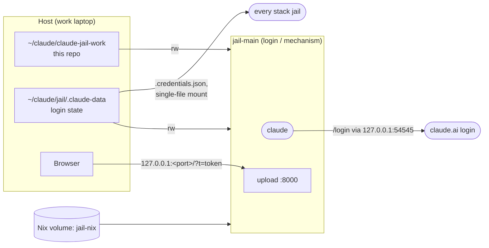

# Security model — the login jail (`jail-main`)

The login jail is the mechanism's own plumbing, not something a developer on a stack opens: it
exists to log the account in once, so that every stack jail can reuse that login, and to work on
this repository (the jails, the launcher, this document) from inside a jail. It holds **no client
content** and no stack credential. Everything below is therefore about one thing: what a session in
`jail-main` can do to the mechanism itself, which the host then runs. The stack jail's model, the
one that matters for client work, is [security.md](security.md); the principle there (tokens and
git are the boundaries, everything else is scenery) and the credential classes apply here unchanged.

## What it is

It mounts this repo read-write, the login state directory, the jail git identity file
(`.claude-data.gitconfig`, which every stack jail copies as its own global git config) and its own
Nix store volume; it is the one session that maps the OAuth callback port. No stack directory, no stack env file, no kubeconfig,
no sidecars: it has no pod-style network namespace, because it has nothing to proxy.

`jail-main` is normally the only session that maps the OAuth callback port
(`stack-jail.sh <stack> --login` is the exception). It logs in once and every stack jail reuses the
token through a single-file mount of `.credentials.json`. The browser reaches a jail's upload server
the same way, on that jail's own loopback port.

## Measures in place

The image and its posture (no sudo, host UID, `cap_drop: [ALL]`, `no-new-privileges`, loopback-only
ports, pinned Nix) are the same as the stack jail's and reviewed there. What is specific:

### Login jail

| Measure | Where | Stops | Review: a diff must not… |
|---|---|---|---|
| Only this repo, the login state, the jail git identity file and its own Nix volume are mounted; no stack directory, env file, kubeconfig or client content | `docker-compose.yml`, `.aliases` | Client content, or a client credential, being reachable from the one jail that can edit the mechanism | The `claude` service must not gain a stack directory, a stack env file or any client content; a change that lets `jail-main` see client material is a finding. |
| No stack credential: the only token is the fork-org `GH_TOKEN` for working on this repo's own fork, held directly (`tools/jail-entrypoint.sh` credential store), no sidecar | `tools/jail-entrypoint.sh`, `.env` | A kind, dev, Argo or registry credential in the jail that edits the mechanism | `jail-main` must not receive any stack token; its git token stays scoped to the fork org and must never gain access to a client's upstream. |
| Pushes are the human's here too: `upstream` is fetch-only (`no_push://disabled`), `origin` is the human's fork | `.git/config` (host-wired), jail card | The mechanism changing upstream except by a reviewed pull request | `upstream` stays fetch-only for this repo; a token or remote that can write to the mechanism's upstream is a finding. |
| The host shell sources a pinned copy of `.aliases` (`~/claude/jail/.aliases.pinned`) that only `jail-pin` updates after showing the diff | `tools/pin-aliases.sh`, `.aliases` | A session editing `.aliases` and the next host shell running it unseen | `.aliases` must keep going through `jail-pin`; a shell that sources the working copy directly is a finding. |
| Only `jail-main` (or a stack jail launched with `--login`) maps the OAuth callback `54545`, on loopback | `.aliases`, `tools/stack-jail.sh` | Several sessions racing for the login callback; the callback reachable off the host | Only `jail-main` or a `--login` launch maps the OAuth callback port, and only on `127.0.0.1`. |

## Accepted risks

- **`jail-main` can edit host-executed files.** It mounts this repo rw, and the host runs from that
  tree: `.aliases`, `stacks/*.conf`, every script in `tools/` that runs on the host (the launcher,
  `stack-fork.sh`, `stack-env.sh`, `host-tools.sh`, `pin-aliases.sh`), and `devbox.json` /
  `devbox.lock`, which decide what `kubectl`, `kind` and `gh` the host scripts run. Accepted: `jail-main` sees no client
  content, so there's little to inject through, every change is a reviewed diff, and the host shell
  sources a pinned copy of `.aliases`. A separate run-only checkout would close it completely if that changes.
- **`jail-main` holds `GH_TOKEN` directly** (`.env`, credential store in `tools/jail-entrypoint.sh`):
  it has no pod namespace and no sidecar. Accepted for now because it sees only this repo, no
  client content to be steered by; the token's scope is still the fork org.
- **It writes the git identity file every stack jail copies.** `.claude-data.gitconfig` is
  mounted read-write here and becomes each stack jail's `~/.gitconfig` at start, so an include,
  alias or credential helper planted there lands in every stack jail's global git config. Accepted:
  that config runs only inside a stack jail, whose git has no token and goes through the sidecar;
  it cannot add a credential or a push target the sidecar does not allow, and the host never reads
  the file.
- **It holds the Anthropic OAuth credentials, read-write**, like every jail (it is where they
  come from). A compromised `jail-main` has the account session; so does a compromised stack jail.

## Open

Nothing specific to the login jail. A separate run-only checkout of this repo for the host (so that
nothing `jail-main` can edit is executed on the host unreviewed) is the one change that would turn
the first accepted risk into a boundary; not built, because `jail-main` sees no client content to be
steered by.
