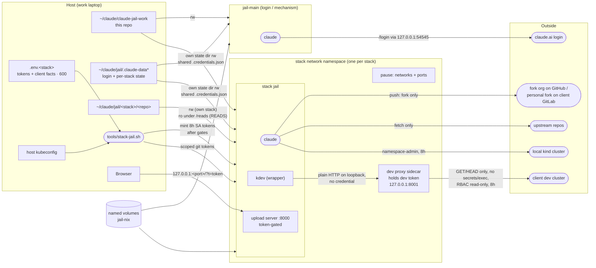

# Security model

What keeps a jail's Claude session inside its jail, which measures are real boundaries and which are
convenience, and what is still open. Generic by rule, like the rest of this repo: no client facts.

**Baseline for comparison:** Claude Code running directly on the host under the employer's managed
policy. It can do everything the host user can. Every measure here makes that smaller; none of
them is needed for the managed policy itself to apply, since the policy arrives with the account
login and is in force in every jail.

## Principle: tokens + git are the boundaries

A jail is safe if no credential inside it can write to an upstream repository or change a client
cluster, *whatever* the session does with it. Everything else is **scenery**: the session card,
the `kdev` verb filter, unsetting env vars. It helps a well-behaved session stay on track but can't
stop a session that has been steered by injected content. The rule for every new feature: if it
only works when Claude cooperates, it is scenery and must not be the thing that keeps a client safe.

## Architecture

`jail-main` is normally the only session that maps the OAuth callback port (`stack-jail.sh <stack> --login` is the exception). It logs in once and every stack
jail reuses the token through a single-file mount of `.credentials.json`.

## Measures in place

### Container

| Measure | Where | Stops |
|---|---|---|
| Only listed paths are mounted: no `~/.ssh`, `~/.kube`, `~/.aws`, Docker socket, host dotfiles | `docker-compose.yml`, `tools/stack-jail.sh` | The session reaching host credentials or controlling Docker |
| No sudo; `node` remapped to the host UID/GID | `Dockerfile` | Container root, which would have host-root reach over the bind mounts |
| Stack jails mount `tools/` read-only and get no part of this repo besides it | `docker-compose.yml` | A stack jail rewriting the launcher, `kdev` or the session card |
| Other stacks' repos (`READS`) mounted read-only, with no tokens or state | `tools/stack-jail.sh` | Writing to or pushing from another stack's tree |
| Jail-only Nix store (`jail-nix` volume, Nix pinned and checksummed in the image); the host `/nix` is never mounted | `Dockerfile`, `docker-compose.yml` | A jail replacing store binaries that the host's devbox or Nix profile runs (the host store is single-user and owned by the host UID) |
| Separate jail git identity; host `~/.gitconfig` not mounted | `docker-compose.yml`, `setup-env.sh` | Host git config (credential helpers, includes) leaking in |
| Permission mode is whatever the managed policy allows; the launcher passes no bypass flag (`JAIL_CLAUDE_FLAGS` exists for a granted exception) | `tools/stack-jail.sh`, `.aliases` | The jail weakening the employer policy |

### Git

| Measure | Where | Stops |
|---|---|---|
| GitHub: fine-grained PAT, resource owner = the fork org, Contents R/W + Metadata, no Pull requests | `.env.<stack>` (filled by the human) | Writing to any upstream or opening PRs |
| Client GitLab: read-only personal token for fetching; a deploy token with `write_repository` scoped to the human's personal fork, which has a protected `main` | `.env.<stack>`, `tools/stack-jail-init.sh` | Writing to the client's upstream or to the fork's `main` |
| Per-host credential store built at session start, path-specific GitLab entry first | `tools/stack-jail-init.sh` | Tokens appearing in remote URLs; the write token being used for the wrong path |
| Each repo's `.git/config` and `.git/hooks` (and every submodule's under `.git/modules`) mounted read-only over the rw repo mount; a `.git` file (worktree) gets a warning instead | `tools/stack-jail.sh` | A jail planting a hook, `core.fsmonitor`, `core.sshCommand` or a filter driver that runs on the **host** the next time host git or an IDE touches the repo. Cost: no repo-config writes in the jail (`push -u`, `remote add`, `branch --set-upstream-to`) |
| Pushes are the human's (`! git push`); by convention `upstream` remotes get `no_push://disabled` as push URL when cloned | jail card, each repo's config | Code reaching upstream except as a merge request the human opens |

### Kubernetes

| Measure | Where | Stops |
|---|---|---|
| Two kubeconfig **files**, never merged: `kind.yaml` (plain `kubectl`), `dev.yaml` (only through `kdev`) | `tools/stack-jail-init.sh` | Pointing a command at the wrong cluster by context mix-up |
| Both tokens minted per launch from the host credential, 8h, then checked for JWT shape and the expected `sub` claim | `tools/stack-jail.sh` | Injecting a long-lived or wrong-subject token |
| Dev SA gate: the launcher reads its **full** `auth can-i --list` by impersonation and refuses to mint if any rule allows a verb besides get/list/watch, or touches `secrets` or a wildcard resource | `tools/stack-jail.sh` | A mis-scoped "read-only" SA (e.g. `list secrets`, `pods/exec`, `serviceaccounts/token`) reaching the jail |
| Dev token never enters the jail: a `kubectl proxy` sidecar in the jail's network namespace holds it and serves on `127.0.0.1:8001`; the jail's `dev.yaml` has no credential. The proxy refuses every method but GET/HEAD and any path segment `secrets`, `exec`, `attach`, `portforward` or `proxy`, for any client (`kdev`, raw `kubectl`, `curl`). Its request log is saved to `~/claude/jail/.run-<stack>/` at session end | `tools/stack-jail.sh` | Token theft (nothing to copy out); writes, secret reads, exec and port-forwards even if a session skips `kdev` |
| `kdev`: read-verb allowlist, refuses `secret` args, prints a cluster banner; runs the repo's devbox `kubectl` with no init_hook | `tools/kdev` | *Convenience.* The proxy and RBAC are the boundary |

### Network and ports

| Measure | Where | Stops |
|---|---|---|
| Stack jails have no network of their own: a pause container owns the namespace (per-stack bridge, kind network, published ports) and the jail and dev proxy join it. The proxy listens on that namespace's loopback, which nothing outside it can reach — host processes, browsers, the LAN, other containers and kind pods included — without depending on firewall rules or the Docker version | `tools/stack-jail.sh`, `docker-compose.yml` | An unauthenticated proxy being reachable by anything that can route to a Docker bridge |
| Both jail services run with `cap_drop: [ALL]` and `no-new-privileges`; sidecars also with a read-only root filesystem and the host UID | `docker-compose.yml`, `tools/stack-jail.sh` | Packet capture on the shared namespace, setuid escalation |
| Every published port binds to `127.0.0.1` | `.aliases`, `tools/stack-jail.sh` | Office/client Wi-Fi reaching the upload server or OAuth listener |
| Upload server: a random token per container (`?t=` for the page, `X-Upload-Token` for uploads); refuses to start without one; 256 MiB cap | `tools/upload/upload.py`, `tools/jail-entrypoint.sh` | kind pods, other jails on the `kind` network, browser CSRF and DNS rebinding dropping files where Claude reads them |
| Only `jail-main` (or a stack jail launched with `--login`) maps the OAuth callback `54545` | `.aliases`, `tools/stack-jail.sh` | Several sessions racing for the login callback |
| Per-jail OTLP identity (`jail.name`, `jail.reads`) | `docker-compose.yml` | Telemetry from different stacks being indistinguishable |

### Repo hygiene

| Measure | Where | Stops |
|---|---|---|
| No client facts in this repo (CIDRs, hostnames, SA names, GitLab URL); they live in the gitignored `.env.<stack>` (mode 600) | `CLAUDE.md`, `.gitignore` | Client data in a repo that may be published |
| Host `~/.zshrc` sources a pinned copy (`~/claude/jail/.aliases.pinned`) that only `jail-pin` updates after showing the diff; a mismatch with the repo prints a warning | `tools/pin-aliases.sh`, host `~/.zshrc` | An unreviewed `.aliases` edit running in every new host shell |

## Accepted risks

- **`jail-main` can edit host-executed files.** It mounts this repo rw, and the host runs
  `.aliases`, the launcher and `stacks/*.conf` from that tree. Accepted: `jail-main` sees no client
  content, so there's little to inject through, every change is a reviewed diff, and the host shell
  sources a pinned copy of `.aliases`. A separate run-only checkout would close it completely if that changes.
- **Client repos are pre-trusted** (`hasTrustDialogAccepted`). A repo-supplied
  `.claude/settings.json` hook would run without a prompt, but inside that jail.
- **Unsetting tokens in `stack-jail-init.sh` hides nothing.** The git tokens and the kind token
  stay readable in `/proc/1/environ`, `~/.git-credentials` and `~/.kube/kind.yaml`. The scope of
  each token is the boundary, not its visibility. (The dev token is the exception: it never enters
  the jail.)
- **Anything running inside the jail can use the dev proxy**, including repo scripts and test code.
  That is the jail's own trust level; the proxy only bounds *what* they can do.
- **Every jail holds the Anthropic OAuth credentials**, read-write for token refresh. A compromised
  jail has the account session.
- **Build inputs are latest-at-build-time** (devbox install script, the Claude Code native
  installer, `debian:trixie` by tag). The image is built locally, not by CI, so nothing
  would bump pins: they would only freeze out security fixes. All come over HTTPS from their
  vendors. Nix is the exception — pinned and checksummed, because it seeds the persistent
  `jail-nix` volume.
- **Network egress is open.** A session can send what it can read anywhere it can reach. The
  answer is to keep what it can read small, not to filter traffic.

## Open

- **kind node escape.** kind nodes are privileged containers, so a namespace admin who can run a
  privileged or `hostPath` pod can probably reach the host. Planned: the launcher refuses the kind
  mint unless the namespace enforces Pod Security `baseline` or `restricted` and the SA cannot
  patch its namespace. The label itself belongs in the lab repo.
- **Shared `jail-nix` across stacks.** One stack's jail can tamper with packages another stack's
  jail runs, which crosses clients. Planned: a `jail-nix-<stack>` volume per stack.
