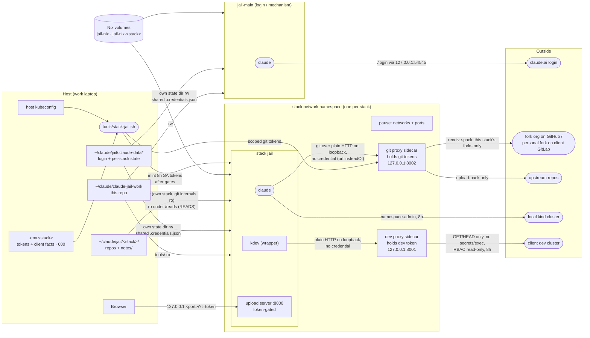

# Security model

What keeps a jail's Claude session inside its jail, which measures are real boundaries and which are
convenience, and what is still open. Generic by rule, like the rest of this repo: no client facts.

**Baseline for comparison:** Claude Code running directly on the host under the employer's managed
policy. It can do everything the host user can. Every measure here makes that smaller; none of
them is needed for the managed policy itself to apply, since the policy arrives with the account
login and is in force in every jail.

## Principle: tokens + git are the boundaries

A jail is safe if no credential inside it can write to an upstream repository or change a client
cluster, *whatever* the session does with it. Everything else is **scenery**: the session card,
the `kdev` verb filter, unsetting env vars. It helps a well-behaved session stay on track but can't
stop a session that has been steered by injected content. The rule for every new feature: if it
only works when Claude cooperates, it is scenery and must not be the thing that keeps a client safe.

The boundary is about what a session can *do*, not what it can *disclose*. A steered session can
read anything mounted and send it anywhere: the managed policy's "don't read secrets" rule is a
prompt, a deny rule on the Read tool does not cover `cat`, and a value printed into a tool result
is already in the transcript, which leaves the jail as conversation content. So nothing here relies
on a credential staying secret. Instead every credential is classed by what its leak would cost:

- **Long** (the account login, the host kubeconfig, the API-scoped tokens the launcher mints
  from): never in a jail.
- **A day** (the per-launch tokens; 8 h or 24 h are the same class, a workday): may enter a jail
  only if its scope is acceptable in an attacker's hands for that day. Today only the kind token
  qualifies, and it is useless outside the host.
- **Harmless** (a token whose leak grants nothing anyone lacks): may enter a jail at any lifetime.
  The one example is the optional `gh` token, a fine-grained PAT with public-repository access and
  no permissions; it buys the authenticated rate limit and nothing else. The launcher can verify
  only part of that (fine-grained, valid, sees no private repository); that it carries no
  permissions is the human's doing when creating it, and a token with Contents write on public
  forks would pass the gate and let the jail push to them past the sidecar's allowlist. Only for
  stacks whose upstreams and forks are all public.
- **Anything else** lives in a sidecar in the jail's network namespace that holds the token and
  enforces policy for whoever calls it: the dev cluster token and all git tokens.

Client content itself (repo source, notes, the facts in the environment) is the job and cannot be
hidden from the session; its disclosure is bounded by keeping what is mounted small, not by a
mechanism.

## Architecture

`jail-main` is normally the only session that maps the OAuth callback port
(`stack-jail.sh <stack> --login` is the exception). It logs in once and every stack jail reuses the
token through a single-file mount of `.credentials.json`.

## Measures in place

### Container

| Measure | Where | Stops |
|---|---|---|
| Only listed paths are mounted: no `~/.ssh`, `~/.kube`, `~/.aws`, Docker socket, host dotfiles | `docker-compose.yml`, `tools/stack-jail.sh` | The session reaching host credentials or controlling Docker |
| No sudo; the `claude` user has the host UID/GID | `Dockerfile` | Container root, which would have host-root reach over the bind mounts |
| Stack jails mount `tools/` read-only and get no part of this repo besides it | `docker-compose.yml` | A stack jail rewriting the launcher, `kdev` or the session card |
| Other stacks' repos (`READS`) mounted read-only, with no tokens or state | `tools/stack-jail.sh` | Writing to or pushing from another stack's tree |
| Jail-only Nix stores (Nix pinned and checksummed in the image): `jail-nix` for the login jail and one `jail-nix-<stack>` volume per stack; the host `/nix` is never mounted | `Dockerfile`, `docker-compose.yml` | A jail replacing store binaries that the host's devbox or Nix profile runs (the host store is single-user and owned by the host UID), or that another stack's jail runs (a cross-client path) |
| Separate jail git identity; host `~/.gitconfig` not mounted | `docker-compose.yml`, `setup-env.sh` | Host git config (credential helpers, includes) leaking in |
| Permission mode is whatever the managed policy allows; the launcher passes no bypass flag (`JAIL_CLAUDE_FLAGS` exists for a granted exception) | `tools/stack-jail.sh`, `.aliases` | The jail weakening the employer policy |

### Git

| Measure | Where | Stops |
|---|---|---|
| GitHub: fine-grained PAT, resource owner = the fork org, Contents R/W + Metadata, no Pull requests | `.env.<stack>` (filled by the human) | Writing to any upstream or opening PRs |
| Client GitLab: read-only personal token for fetching; a deploy token with `write_repository` scoped to the human's personal fork, which has a protected `main` | `.env.<stack>`, `tools/stack-jail.sh` | Writing to the client's upstream or to the fork's `main` |
| **No git token in the jail.** A `gitproxy` sidecar in the jail's network namespace holds all three, serves git smart-HTTP on `127.0.0.1:8002`, and the jail's `~/.gitconfig` rewrites every URL shape of both hosts to it (`url.insteadOf`); repo configs stay as the host wrote them. The sidecar forwards only `info/refs`, `git-upload-pack` and `git-receive-pack`, drops client `Authorization` headers, answers an upstream 401 as 403, accepts `git-receive-pack` only for `FORK_ORG/<repo>` of this stack's repos and `GITLAB_FORK_PATH`, and sends the GitHub token only for those forks and `UPSTREAM_OWNER/<repo>` (every other github.com repo is fetched anonymously), for any client. Its request log is saved to `~/claude/jail/.run-<stack>/` at session end | `tools/gitproxy/gitproxy.py`, `docker-compose.yml`, `tools/stack-jail.sh`, `tools/stack-jail-init.sh` | Token theft (nothing to copy out of the jail); a push to another stack's fork in the same org, or to anything a mis-scoped token would allow; the GitHub/GitLab REST API with the tokens; a session's git config pointing a push elsewhere |
| Each repo's `.git/config`, `.git/hooks` and `.git/commondir` (and every submodule's under `.git/modules`, and the notes repo's) mounted read-only over the rw repo mount. `commondir` is written as `.` on the host first: git would otherwise follow a planted `commondir` to a config the jail controls. A pre-existing `commondir` other than `.` stops the launch; a `.git` file (worktree) gets a warning | `tools/stack-jail.sh` | A jail planting a hook, `core.fsmonitor`, `core.sshCommand` or a filter driver that runs on the **host** the next time host git or an IDE touches the repo. Cost: no repo-config writes in the jail (`push -u`, `remote add`, `branch --set-upstream-to`) |
| Host-side git audit at launch and exit: nested repositories planted in a working tree (real submodules excepted), a changed `commondir`, `config.worktree`, linked worktrees | `tools/stack-jail.sh` | What mounts cannot block: an IDE auto-detecting a planted nested repo and running git in it with *its* config. Warns; deleting is the human's call |
| Remotes are set only on the host, by `tools/stack-fork.sh` with your own `gh` login: fork into the fork org (checked to really be a fork of the upstream), `upstream` with push URL `no_push://disabled`, `origin` = the fork. Its git calls into existing clones are hardened like the notes snapshots | `tools/stack-fork.sh` | An accidental push to upstream; a jail rewiring remotes (it can't: `.git/config` is read-only) |
| Pushes are the human's (`! git push`) | jail card | Code reaching upstream except as a merge request the human opens |

### Kubernetes

| Measure | Where | Stops |
|---|---|---|
| Two kubeconfig **files**, never merged: `kind.yaml` (plain `kubectl`), `dev.yaml` (only through `kdev`) | `tools/stack-jail-init.sh` | Pointing a command at the wrong cluster by context mix-up |
| Both tokens minted per launch from the host credential, 8h, then checked for JWT shape and the expected `sub` claim | `tools/stack-jail.sh` | Injecting a long-lived or wrong-subject token |
| kind gate: no token unless the stack namespace enforces Pod Security `baseline`/`restricted`, and the SA cannot patch/update/delete that namespace, create namespaces or create pods elsewhere | `tools/stack-jail.sh` | A namespace admin running a privileged, `hostPath` or `hostPID` pod on a privileged kind node, i.e. reaching the host |
| Dev SA gate: the launcher reads its **full** `auth can-i --list` by impersonation and refuses to mint if any rule allows a verb besides get/list/watch, or touches `secrets` or a wildcard resource | `tools/stack-jail.sh` | A mis-scoped "read-only" SA (e.g. `list secrets`, `pods/exec`, `serviceaccounts/token`) reaching the jail |
| Dev token never enters the jail: a `kubectl proxy` sidecar in the jail's network namespace holds it and serves on `127.0.0.1:8001`; the jail's `dev.yaml` has no credential. The proxy refuses every method but GET/HEAD and any path segment `secrets`, `exec`, `attach`, `portforward` or `proxy`, for any client (`kdev`, raw `kubectl`, `curl`). Its request log is saved to `~/claude/jail/.run-<stack>/` at session end | `tools/stack-jail.sh` | Token theft (nothing to copy out); writes, secret reads, exec and port-forwards even if a session skips `kdev` |
| `kdev`: read-verb allowlist, refuses `secret` args, prints a cluster banner; runs the repo's devbox `kubectl` with no init_hook | `tools/kdev` | *Convenience.* The proxy and RBAC are the boundary |

### Network and ports

| Measure | Where | Stops |
|---|---|---|
| Stack jails have no network of their own: a pause container owns the namespace (per-stack bridge, kind network, published ports) and the jail and dev proxy join it. The proxy listens on that namespace's loopback, which nothing outside it can reach — host processes, browsers, the LAN, other containers and kind pods included — without depending on firewall rules or the Docker version | `tools/stack-jail.sh`, `docker-compose.yml` | An unauthenticated proxy being reachable by anything that can route to a Docker bridge |
| Both jail services run with `cap_drop: [ALL]` and `no-new-privileges`; sidecars also with a read-only root filesystem and the host UID | `docker-compose.yml`, `tools/stack-jail.sh` | Packet capture on the shared namespace, setuid escalation |
| Every published port binds to `127.0.0.1` | `.aliases`, `tools/stack-jail.sh` | Office/client Wi-Fi reaching the upload server or OAuth listener |
| Upload server: a random token per container (`?t=` for the page, `X-Upload-Token` for uploads); refuses to start without one; 256 MiB cap | `tools/upload/upload.py`, `tools/jail-entrypoint.sh` | kind pods, other jails on the `kind` network, browser CSRF and DNS rebinding dropping files where Claude reads them |
| Only `jail-main` (or a stack jail launched with `--login`) maps the OAuth callback `54545` | `.aliases`, `tools/stack-jail.sh` | Several sessions racing for the login callback |
| Per-jail OTLP identity (`jail.name`, `jail.reads`) | `docker-compose.yml` | Telemetry from different stacks being indistinguishable |

### Repo hygiene

| Measure | Where | Stops |
|---|---|---|
| Per-stack `notes/` next to the repos: outside every repo, a local git repo with no remote, snapshotted by the launcher before and after each session with a hardened host-side git (explicit `GIT_DIR`/`GIT_COMMON_DIR`, fsmonitor and hooks off, no host config). The upload inbox lives in `notes/uploads/` (gitignored) | `tools/stack-jail.sh` | Notes or uploaded screenshots being committed to a client repo; agent-written notes going unreviewed (`git -C notes log -p`) |
| No client facts in this repo (CIDRs, hostnames, SA names, GitLab URL); they live in the gitignored `.env.<stack>` (mode 600) | `CLAUDE.md`, `.gitignore` | Client data in a repo that may be published |
| Host-side scripts take `kubectl`, `kind` and `gh` from this repo's `devbox.json` (exact versions), never from a stack repo's devbox, which a jail can write | `tools/host-tools.sh`, `devbox.json` | A stale host binary breaking a gate (an old `kubectl` without `create token`); a jail-planted "kubectl" running on the host with your credentials |
| Host `~/.zshrc` sources a pinned copy (`~/claude/jail/.aliases.pinned`) that only `jail-pin` updates after showing the diff; a mismatch with the repo prints a warning | `tools/pin-aliases.sh`, host `~/.zshrc` | An unreviewed `.aliases` edit running in every new host shell |

## Accepted risks

- **`jail-main` can edit host-executed files.** It mounts this repo rw, and the host runs from that
  tree: `.aliases`, `stacks/*.conf`, every script in `tools/` that runs on the host (the launcher,
  `stack-fork.sh`, `stack-env.sh`, `host-tools.sh`, `pin-aliases.sh`), and `devbox.json` /
  `devbox.lock`, which decide what `kubectl`, `kind` and `gh` the host scripts run. Accepted: `jail-main` sees no client
  content, so there's little to inject through, every change is a reviewed diff, and the host shell
  sources a pinned copy of `.aliases`. A separate run-only checkout would close it completely if that changes.
- **The host IDE shares the jail's working tree.** Mounts and the audit keep git's own machinery
  from running jail-written code. Build files are different: `pom.xml`, `.mvn/`, `devbox.json`
  hooks, `.envrc`, `.vscode/`, `.idea/` run when you build, import or open them on the host. Review
  the diff before building on the host, and keep IDE auto-run features (automatic tasks, Maven
  auto-import, nested-repo auto-detection) off for these folders.
- **Notes persist across sessions in both directions.** A session steered by injected content could
  leave instructions for later sessions there, as it could in Claude's own memory. The snapshots
  make that reviewable, not impossible.
- **Client repos are pre-trusted** (`hasTrustDialogAccepted`). A repo-supplied
  `.claude/settings.json` hook would run without a prompt, but inside that jail.
- **The kind token is readable in the jail** (`/proc/1/environ`, `~/.kube/kind.yaml`), and
  unsetting it in `stack-jail-init.sh` hides nothing. Accepted by the credential classes above: a
  day-class token whose API server is loopback-only on the host. The git and dev tokens never enter
  the jail.
- **Anything running inside the jail can use both proxies**, including repo scripts and test code:
  fetch any repo on the two git hosts with the read tokens, push to the stack's forks, read the dev
  cluster. That is the jail's own trust level; the proxies only bound *what* they can do, and log it.
- **`jail-main` holds `GH_TOKEN` directly** (`.env`, credential store in `tools/jail-entrypoint.sh`):
  it has no pod namespace and no sidecar. Accepted for now because it sees only this repo, no
  client content to be steered by; the token's scope is still the fork org.
- **`gh` in a stack jail is a read tool with a public-only token, or unauthenticated.** The
  harmless-class token above is in the jail's environment on purpose. Its permission set cannot be
  probed without writing, so "no permissions" rests on the human's token setup; the gate only
  proves it is fine-grained, valid and blind to private repositories. Without it, `gh` still answers
  public reads at the anonymous rate limit, which is throttled at random times. Either way every
  write is refused by GitHub, not by anything in the jail.
- **Every jail holds the Anthropic OAuth credentials**, read-write for token refresh. A compromised
  jail has the account session.
- **Build inputs are latest-at-build-time** (devbox install script, the Claude Code native
  installer, `debian:trixie` by tag). The image is built locally, not by CI, so nothing
  would bump pins: they would only freeze out security fixes. All come over HTTPS from their
  vendors. Deliberate exceptions, bumped by hand: Nix (pinned and checksummed — it seeds the
  persistent Nix volumes), the host tools in `devbox.json`, and the `kubectl` and `pause` sidecar
  images in the launcher.
- **Network egress is open.** A session can send what it can read anywhere it can reach. The
  answer is to keep what it can read small, not to filter traffic.

## Open

- **kind Pod Security label.** The launcher now refuses the kind token without it (see above), but
  the label itself (`pod-security.kubernetes.io/enforce: baseline` on each stack namespace) still
  has to be added where the SA and RoleBinding live, in the lab repo.
- **Read-only API access through the sidecar (`gh`, later `glab`) for stacks with private
  repos.** The public-only `gh` token stops being harmless the moment a fork or upstream is
  private. The design that keeps `gh` working natively is an *explicit* proxy: the sidecar also
  serves as `HTTPS_PROXY` for the jail; it tunnels `CONNECT` blindly for every host except the git
  hosts and `api.github.com`, which it terminates with a per-launch CA the launcher generates (the
  jail trusts it through `SSL_CERT_FILE`, `GIT_SSL_CAINFO`, `NODE_EXTRA_CA_CERTS`,
  `REQUESTS_CA_BUNDLE`; Java ignores all of them and goes direct, credential-less, as now). Policy
  on `api.github.com`: GET only on REST, and GraphQL POST only when the document contains no
  `mutation`, which keeps `pr list/view/checks`, `run view --log` and `gh api` reads and refuses
  `pr create/merge`, comments and every other write. The jail gets a dummy `GH_TOKEN` so `gh`
  believes it is logged in; the sidecar drops it and adds the real one. `gh`'s only plain-HTTP
  mode (`GH_HOST=github.localhost`) was rejected: its repo detection reads the raw remote URLs,
  so every in-repo command would need `-R`. Cost: ~200 lines in `gitproxy.py`, CA plumbing in the
  launcher and init; `url.insteadOf` becomes unnecessary since git can use its real URLs through
  the same proxy. Side effect: the sidecar log becomes an egress log for everything that honours
  the proxy env.
