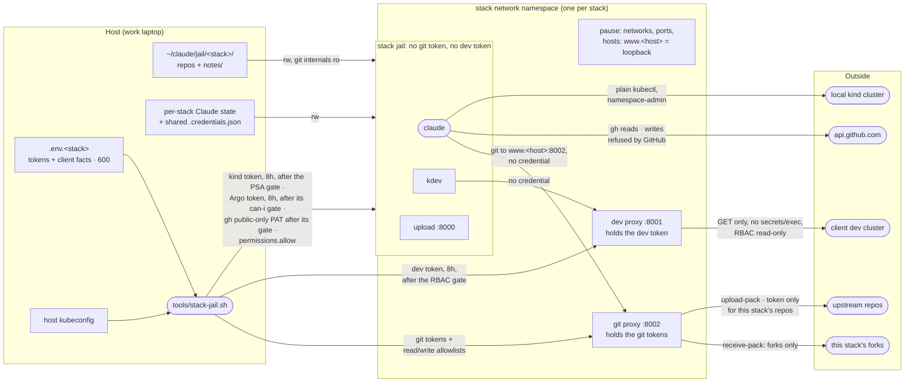

# Security model — the stack jail

What keeps a stack jail's Claude session inside its jail, which measures are real boundaries and
which are convenience, and what is still open. Generic by rule, like the rest of this repo: no
client facts. This is the document for the jail a developer uses. The login jail (`jail-main`) is
the mechanism's own plumbing, and its model is separate and short:
[security-jail-main.md](security-jail-main.md).

**Baseline for comparison:** Claude Code running directly on the host under the employer's managed
policy. It can do everything the host user can. Every measure here makes that smaller; none of
them is needed for the managed policy itself to apply, since the policy arrives with the account
login and is in force in every jail.

## Principle: tokens + git are the boundaries

A jail is safe if no credential inside it can write to an upstream repository or change a client
cluster, *whatever* the session does with it. Everything else is **scenery**: the session card,
the `kdev` verb filter, unsetting env vars. It helps a well-behaved session stay on track but can't
stop a session that has been steered by injected content. The rule for every new feature: if it
only works when Claude cooperates, it is scenery and must not be the thing that keeps a client safe.

The boundary is about what a session can *do*, not what it can *disclose*. A steered session can
read anything mounted and send it anywhere: the managed policy's "don't read secrets" rule is a
prompt, a deny rule on the Read tool does not cover `cat`, and a value printed into a tool result
is already in the transcript, which leaves the jail as conversation content. So nothing here relies
on a credential staying secret. Instead every credential is classed by what its leak would cost:

- **Long** (the account login, the host kubeconfig, the API-scoped tokens the launcher mints
  from): never in a jail.
- **A day** (the per-launch tokens; 8 h or 24 h are the same class, a workday): may enter a jail
  only if its scope is acceptable in an attacker's hands for that day. Today the kind token and
  the Argo CD token (get and sync on the stack's own kind Applications) qualify, and both are
  useless outside the host.
- **Harmless** (a token whose leak grants nothing anyone lacks): may enter a jail at any lifetime.
  The one example is the optional `gh` token, a fine-grained PAT with public-repository access and
  no permissions; it buys the authenticated rate limit and nothing else. The launcher can verify
  only part of that (fine-grained, valid, sees no private repository); that it carries no
  permissions is the human's doing when creating it, and a token with Contents write on public
  forks would pass the gate and let the jail push to them past the sidecar's allowlist. Only for
  stacks whose upstreams and forks are all public.
- **Anything else** lives in a sidecar in the jail's network namespace that holds the token and
  enforces policy for whoever calls it: the dev cluster token and all git tokens.

A corollary for what the launcher *prints*: terminal output is transcript-bound. Humans copy launch
logs into chats, tickets and AI sessions, and nobody rotates a token after pasting it, so anything
printed must be safe to expose for its whole lifetime and blast radius, unrotated. The one
token any jail prints, the upload server's, is container-lifetime and buys only a file drop into
the notes inbox; a stack jail's gates print what they verified, never the value.

Client content itself (repo source, notes, the facts in the environment) is the job and cannot be
hidden from the session; its disclosure is bounded by keeping what is mounted small, not by a
mechanism.

## The managed policy: what it can express, what it can't, and why that is fine here

The employer's managed settings are the layer above every jail. It helps to be precise about what
that layer is, because this repo exists in the gap it leaves. Everything below is from the Claude
Code docs (permissions, managed settings, server-managed settings, permission modes).

**What it can express.** Deny, ask and allow rules, matched against the text of a tool call:
`Bash(kubectl apply *)` is a glob over the command string Claude writes. Evaluation is deny, then
ask, then allow, and an allow never carves an exception out of a deny. Managed rules sit above
user, project and local settings. A policy delivered through the claude.ai console (the only
delivery on a Team or Enterprise plan without MDM) is one policy for everyone it reaches: the
console "can't target a group yet", settings restricted to OS-level sources such as `policyHelper`
(a program that computes the policy per user, team or repository at startup) "aren't honored"
there, and there is no conditional rule syntax (no "push to the fork but not upstream", no
cwd-scoped rule). Per-group policy needs MDM-delivered files, or the self-hosted gateway, which
routes inference through the organisation's own cloud provider. The documented options for an
admin whose global deny is too coarse: `ask` instead of `deny` (the human confirms each call),
`policyHelper` via MDM, or sandboxing with OS-level network and filesystem allowlists.

**What matching covers.** Compound commands are split and subshells are looked into, so
`cd x && git push` still matches `git push *`. A short list of wrappers is stripped before
matching (`timeout`, `nice`, `nohup`, `time`, `command`, `builtin`, bare `xargs`). Development
runners are *not* stripped: `devbox run`, `direnv exec`, `npx`, `docker exec`. The same program
by path (`/usr/bin/git push`), inside `sh -c`, or in a script, is not matched either. The docs say
it in one sentence: a Bash rule "isn't a security boundary around the program", and recommend
sandboxing "when the restriction must hold". The rules are enforced by Claude Code at call time;
the model never sees the deny list, and `CLAUDE.md` "shapes what Claude tries to do, but doesn't
change what Claude Code allows". The auto-mode classifier reads intent across the conversation
and does refuse some sandbox-weakening moves, but the documented blocked-by-default categories
contain nothing about routing around a deny rule, so that is luck, not a control.

**The consequence in a jail.** The jails run their tooling through Devbox, and the image carries
no `kubectl`, `gh` or `helm` of its own. `devbox run kubectl apply -f x` matches no
`Bash(kubectl apply *)` rule, and neither does a one-line script that execs `git push`. The deny
list is, in this environment, exactly what the Principle section calls scenery: it holds for the
invocation a cooperative session usually writes and for nothing else.

**Why that is acceptable.** The default policy is written for vanilla Claude Code on a laptop,
where the host's own credentials are in reach: a kubeconfig that can write to a client cluster, a
git token that can push to upstream. There, the deny on `kubectl apply` and `git push` is the only
thing between the model and the damage, and a text rule that catches the usual invocation is a
reasonable default for that shape. A team that brings its own tooling (runners, wrappers, its own
`aws`, `glab` or `gh`, a jail) has left that shape, and is expected to bring its own enforcement
with it. This repo is that enforcement. What stops a write to the dev cluster is the proxy
refusing every method but GET and the RBAC gate, whatever the command text; on kind, `apply` is
allowed and harmless (disposable, namespace-scoped, Pod Security gated). What stops a push to
upstream is the sidecar accepting receive-pack only for the forks and the repo config being
read-only, not the deny on `git push`. The policy keeps its value as a statement of intent and as
a brake on a cooperative session, which is why the jail card tells sessions not to route around
it, through `devbox run` or anything else, and why pushes stay the human's unless the policy owner
grants the exception explicitly.

## Architecture

The stack jail holds client code, and every credential it can reach is either scoped to a day and
harmless, or behind a sidecar. (The account login it reuses comes from the login jail; see
[security-jail-main.md](security-jail-main.md).)

## Measures in place

### Container

| Measure | Where | Stops | Review: a diff must not… |
|---|---|---|---|
| Only listed paths are mounted: no `~/.ssh`, `~/.kube`, `~/.aws`, Docker socket, host dotfiles | `docker-compose.yml`, `tools/stack-jail.sh` | The session reaching host credentials or controlling Docker | Any new mount into a jail is a finding unless it is a listed stack path — never a credential dir, the Docker socket or a host dotfile. |
| No sudo; the `claude` user has the host UID/GID | `Dockerfile` | Container root, which would have host-root reach over the bind mounts | A `Dockerfile` change that adds sudo, a setuid binary or a UID/GID other than the host's is a finding. |
| Stack jails mount `tools/` read-only and get no part of this repo besides it | `docker-compose.yml` | A stack jail rewriting the launcher, `kdev` or the session card | A stack jail must not get this repo read-write, nor anything of it besides `tools/` read-only. |
| Other stacks' repos (`READS`) mounted read-only, with no tokens or state | `tools/stack-jail.sh` | Writing to or pushing from another stack's tree | `READS` mounts stay read-only and token-less; a writable mount of another stack's tree is a finding. |
| Jail-only Nix stores (Nix pinned and checksummed in the image): one `jail-nix-<stack>` volume per stack (the login jail has its own); the host `/nix` is never mounted | `Dockerfile`, `docker-compose.yml` | A jail replacing store binaries that the host's devbox or Nix profile runs (the host store is single-user and owned by the host UID), or that another stack's jail runs (a cross-client path) | The host `/nix` is never mounted and each stack keeps its own store volume; an unpinned or unchecksummed Nix install in the image is a finding. |
| A per-stack Maven cache volume (`jail-m2-<stack>`, mounted at `~/.m2`): a full build per session is too slow, and it holds what the stack's builds download — same trust as the stack's Nix store, never shared across stacks, never the host's `~/.m2` | `docker-compose.yml` | A jail planting a settings file or a poisoned artifact that another stack's build, or the host's Maven, would use | `~/.m2` stays a per-stack volume; mounting the host's or sharing one across stacks is a finding. |
| Separate jail git identity; host `~/.gitconfig` not mounted | `docker-compose.yml`, `setup-env.sh` | Host git config (credential helpers, includes) leaking in | Do not mount the host `~/.gitconfig` or any other host dotfile into a jail. |
| No Docker in the jail, and no image push from it. A stack that names a `BUILDER_IMAGE` gets a build sidecar (`tools/builder/`: that Paketo builder plus helm) in the jail's network namespace, same posture as the proxies (read-only root, no capabilities, no-new-privileges, host UID). It runs the CNB lifecycle creator on requests the jail drops into the shared `build/` dir — each copied into the sidecar's own tmpfs before anything reads it, links kept as links, the copy refused if it holds a symlink or special file and built from otherwise, so a swap in the shared dir after the check reaches nothing; pack's `/workspace` and `/layers` are host-only dirs under `.run-<stack>/` — exports the image and pushes the chart to the stack's kind registry, and refuses any name outside `BUILD_NAMES`. The registry credential, if the registry wants one, is read by the sidecar and never written where the jail can read it | `tools/builder/`, `tools/build-image`, `tools/stack-jail.sh` | A Docker socket or a daemon-backed build in the jail (host-root reach); a looser jail (user namespaces, seccomp unconfined) for rootless podman; pushes to names outside the stack's own | No Docker socket, daemon or rootless-podman setup in a jail; pushes stay in the sidecar, bounded by `BUILD_NAMES` and by the registry's own policy (the boundary: build code the jail supplies runs inside the sidecar and can lift the credential there, an accepted risk, so secrecy is not what holds); the launcher and the sidecar themselves must not write the credential anywhere the jail reads, so the sidecar reads a request only from its tmpfs copy and keeps its work dirs out of the shared build dir. |
| Permission mode is whatever the managed policy allows; the launcher passes no bypass flag (`JAIL_CLAUDE_FLAGS` exists for a granted exception). It does pin a `permissions.allow` list into the stack jail's own settings (default: everything per tool, `JAIL_ALLOW` in the stack conf overrides), which skips the prompt / auto-mode classifier for those tools; a managed deny still wins, and a managed policy may ignore non-managed rules | `tools/stack-jail.sh`, `.aliases` | The jail weakening the employer policy. (The allow list is scenery by design: prompts inside a stack jail guard nothing the tokens and mounts don't; the jail could edit its own settings file anyway) | The launcher must not pass a permission-bypass flag or override managed rules; a pinned allow rule must not become a wrapper around a denied command. |

### Git

Terms, because the mechanism rests on them. A **repo dir** is a `REPOS` entry under the stack home,
mounted read-write at `/workspace/<name>`; the conf decides that, and it says nothing about git. A
**gitdir** is `<repo dir>/.git` as a directory, and that is the only kind there is here: a `.git`
pointer file or symlink (git follows either to any gitdir), or a `.git/modules` dir, stops the
launch — **submodules are not supported**, each would be one more gitdir to protect and audit, and
git names them after their path. A **recorded gitdir** is one listed, with its inode, in the
host-only record `~/claude/jail/.run-<stack>/gitdirs`: written by `stack-fork.sh` for the clones it
makes, by the launcher for the notes repo it creates, and by `stack-jail.sh <stack> --adopt
<dir>/.git` for what the human made on the host and has looked at. Only a recorded gitdir is
mounted protected, has its remotes read for the push and read lists, and is not an audit hit. A
**local-only dir** is a repo dir with no recorded gitdir, and it stays one if a `.git` appears in
it. A gitdir on disk that is not recorded, or whose inode differs from the record, is a **planted
gitdir** until the human says otherwise: it stops the launch before any token is minted, and the
exit audit reports it the same day. Against the jail the record is exact: in the jail a repo dir
and its gitdir are both mountpoints, so a session can neither rename nor replace them, and a
gitdir absent at any launch is pruned from the record, so one a session makes at that path later
is unrecorded. The inode is for the host side: a directory replaced by hand with no launch in
between shows as replaced, unless the filesystem reused the inode number, which only the human's
own delete-and-re-clone can bring about and is accepted. The scan (`tools/gitdir-scan.sh`) uses
`find` and `ls` only, never git, treats a directory it cannot read as a refusal, and ends with a
marker line: a launch or audit that does not see it fails closed. Trust comes from the record,
never from presence on disk, because the jail writes the disk.

| Measure | Where | Stops | Review: a diff must not… |
|---|---|---|---|
| GitHub: fine-grained PAT, resource owner = the fork org, Contents R/W + Metadata, no Pull requests | `.env.<stack>` (filled by the human) | Writing to any upstream or opening PRs | The documented PAT stays fine-grained, fork-org scoped, Contents + Metadata only, no Pull requests permission. |
| Client GitLab: read-only personal token for fetching; a deploy token with `write_repository` scoped to the human's personal fork, which has a protected `main` | `.env.<stack>`, `tools/stack-jail.sh` | Writing to the client's upstream or to the fork's `main` | GitLab write stays a deploy token on the human's fork with protected `main`; any token with upstream write reach is a finding. |
| **No git token in the jail.** A `gitproxy` sidecar in the jail's network namespace holds all three and serves git smart-HTTP on `127.0.0.1:8002`, addressed as `http://www.<host>:8002/` (the launcher maps `www.github.com` and `www.<GITLAB_HOST>` to loopback in the namespace holder's `/etc/hosts`; the proxy picks the upstream from the Host header out of that fixed list; the `www.` form is what keeps `gh` resolving the repo from `git remote -v`). The jail's `~/.gitconfig` rewrites every URL shape of both hosts to it (`url.insteadOf`); repo configs stay as the host wrote them. The sidecar forwards only `info/refs`, `git-upload-pack` and `git-receive-pack`, drops client `Authorization` headers, answers an upstream 401 as 403, accepts `git-receive-pack` only for this stack's forks, read on the host from each recorded gitdir's `origin` (the owner must be `FORK_ORG`; a local-only dir is not listed, whatever `.git` it holds) and `GITLAB_FORK_PATH`, and sends the GitHub token only for those forks and each clone's `upstream` (every other github.com repo is fetched anonymously), for any client. Its request log is saved to `~/claude/jail/.run-<stack>/` at session end | `tools/gitproxy/gitproxy.py`, `docker-compose.yml`, `tools/stack-jail.sh`, `tools/stack-jail-init.sh` | Token theft (nothing to copy out of the jail); a push to another stack's fork in the same org, or to anything a mis-scoped token would allow; the GitHub/GitLab REST API with the tokens; a session's git config pointing a push elsewhere | Nothing may put a git token into a jail's env, files or config; the proxy may forward only the three smart-HTTP endpoints, must drop client `Authorization`, and must accept pushes only for the stack's forks. |
| Each recorded gitdir's `config`, `hooks` and `commondir` (the repos' `.git` and the notes repo's) mounted read-only over the rw repo mount, and each gitdir is a bind mount of its own: a mountpoint cannot be renamed away and replaced by a jail-made gitdir (a directory that merely contained the three mounts could). Symlinks in those places stop the launch. `commondir` is written as `.` on the host first: git would otherwise follow a planted `commondir` to a config the jail controls. A pre-existing `commondir` other than `.` stops the launch. A gitdir that is on disk but not in the record, or replaced since it was recorded (absent gitdirs are pruned at each launch; a replaced one has a new inode), stops the launch (with the exact `--adopt` command), so a session cannot turn a local-only dir into a "clone" the next launch would protect, trust and read remotes from; a `.git` pointer file, symlink or `modules` dir stops it outright | `tools/stack-jail.sh`, `tools/gitdir-scan.sh`, `tools/stack-fork.sh` | A jail planting a hook, `core.fsmonitor`, `core.sshCommand` or a filter driver that runs on the **host** the next time host git or an IDE touches the repo. Cost: no repo-config writes in the jail (`push -u`, `remote add`, `branch --set-upstream-to`) | `.git/config`, `hooks` and `commondir` stay read-only in stack jails with `commondir` normalized first, and a gitdir is trusted only through the host-side record by path and inode (`stack-fork.sh` for clones it makes, `--adopt` by explicit name), never because it exists; a change that lets a jail write repo config, adopts a gitdir by its presence, or admits submodules, pointer files or symlinked gitdirs, is a finding. |
| Host-side git audit at launch and exit, from the same scan as the launch check: nested repositories planted in a working tree (local-only dirs and the build dir included; `.git` dirs, files and links alike), a gitdir that is not recorded or was recreated, a `.git` pointer file or `modules` dir, an unreadable directory, an in-progress rebase or sequencer (its todo would run `exec` lines on the host at `--continue`), a changed `commondir`, `config.worktree`, linked worktrees, and a gitdir or config swapped for another (inode and checksum recorded at launch); paths printed quoted, so a name cannot hide the warning | `tools/stack-jail.sh` | What mounts cannot block: an IDE auto-detecting a planted nested repo and running git in it with *its* config. Warns; deleting is the human's call | The launch and exit audit for planted nested repos, unrecorded gitdirs, worktrees, in-progress rebase or sequencer state and `commondir` stays, covers local-only dirs and the build dir, and fails closed when the scan does not run; silencing or narrowing it, or letting it run git, is a finding. |
| Remotes are set only on the host, by `tools/stack-fork.sh` with your own `gh` login: fork into the fork org (checked to really be a fork of the upstream), `upstream` with push URL `no_push://disabled`, `origin` = the fork. Its git calls into existing clones set `GIT_DIR`, `GIT_COMMON_DIR` and `GIT_WORK_TREE` explicitly and disable fsmonitor and hooks; they do read your own git config, on purpose (it is the `gh`-wired identity doing the forking) | `tools/stack-fork.sh` | An accidental push to upstream; a jail rewiring remotes (it can't: `.git/config` is read-only) | Remotes are wired only by `stack-fork.sh`; `upstream` keeps the disabled push URL and the fork is verified to be a fork of the upstream. |
| One actor per stack at a time: a lock directory in the run dir held by a launch, a `--adopt` and `stack-fork.sh` for their whole run, plus a refusal while the stack's namespace holder (the session) runs; the pre-session audit, run after the mounts are decided, is fatal on any gitdir those mounts do not cover | `tools/stack-jail.sh`, `tools/stack-fork.sh` | A second launch scanning a tree the first session is writing and tearing its sidecars down; a clone made during a launch's gates being mounted with writable config | The launch, `--adopt` and `stack-fork.sh` keep taking the per-stack lock, a launch stays refused while the session's namespace holder runs, and the pre-session audit stays fatal; a diff that removes any of the three is a finding. |
| `--second`: a second Claude started by `docker exec` in the running `jail-<stack>`, after the launcher checks that container runs; it takes no lock and runs no gates because it adds no credential, mount, port or sidecar, its init writes no file (the first session's are live), and it stops with the first session. Its rules (`tools/second-jail.md`: write only under `notes/`, no git writes, read-only cluster use) are discipline, not a boundary | `tools/stack-jail.sh`, `tools/second-jail.md` | A second full launch (scan, mints, cleanup) racing the first; nothing beyond that — it holds what the first session holds | `--second` stays a `docker exec` into the running jail that passes no `-e`, `-v`, `-p` or `--privileged` and mints nothing, and refuses when the jail is not running; a diff that gives it anything the first session lacks is a finding. |
| Pushes are the human's (`! git push`) | jail card | Code reaching upstream except as a merge request the human opens | Nothing in a jail may push, wrap `git push`, or route a denied verb through a script, `bash -c`, a path or `devbox run` until the AI team's written approval is recorded in this document. |

### Kubernetes

Two gates run before any kind or Argo token is minted; both fail closed. The table below holds
the rules; this is how the gates work.

**The kind gate** asks, as the workbench SA, what it could do, and refuses the mint unless all of
this holds: the stack namespace enforces Pod Security `baseline` or `restricted`; the SA cannot
patch, update or delete that namespace (asked with the namespace set, the way the API evaluates a
request on `namespaces/<ns>`, so a RoleBinding inside it counts) and cannot create namespaces; and
its whole `can-i --list`, taken in every namespace, shows in a namespace without a Pod Security
label nothing but get/list/watch rules (no secrets, no `*/proxy`, `exec`, `attach`, `portforward`
or `ephemeralcontainers` with any verb — a Deployment, Job or `pods/exec` grant counts as much as
`create pods`), and in a labelled one no patch/update/delete on `namespaces` and no `nodes/proxy`
(the kubelet API, cluster-scoped, so it shows in every namespace's list). The stack namespace's own
`pods/exec` is namespace-admin by design, bounded by the label; in any other labelled namespace a
shell subresource is refused too (an exec into Argo's controller is a cluster-admin shell). A
namespace list that fails or is empty refuses. Two cluster-level checks come with it: no Service
may carry `externalIPs` (kube-proxy would route the node's own address to a pod), and the cluster
is created with the `DenyServiceExternalIPs` admission plugin next to kubeadm's default
`NodeRestriction` — the gate warns when the first is absent and refuses when the second is.

**Argo CD** is the deploy half, when the conf lists `ARGO_APPS`. `kind-stack.sh` installs it from
the pinned upstream manifest with one Application per chart name tracking the stack registry (any
version) and an AppProject that allows only that registry as source, only the stack namespace as
destination, no cluster-scoped kinds and no namespaced Role or RoleBinding (a chart could otherwise
have the cluster-admin controller bind the workbench SA to cluster-admin inside the namespace,
which authorises patching the namespace label away); the install's `default` project is emptied.
The workbench SA gets a read Role in `argocd` (applications, appprojects), nothing more.

**Cluster add-ons** are what a namespace-admin jail cannot install: charts that bring CRDs,
ClusterRoles or webhooks (the first is kube-prometheus-stack, so a stack's chart can ship a
ServiceMonitor). A conf opts in with `KIND_ADDONS`; each name is a file `addons/<name>.yaml` in
this repo — one Application, a public `https` chart repo, an exact chart version, a namespace of its
own — and `kind-stack.sh up` refuses the run unless the file says what the conf says (name,
`argocd`, project `platform`, one document, one source; never the stack registry, which the jail
pushes to). It then applies a second AppProject, `platform`, whose sources and destinations are
exactly the repos and namespaces those files declare and which allows every cluster-scoped kind,
and the files. Nothing in a jail is granted on it: the jail account's policy stays `<stack>/*`, so
a session sees the platform apps through its read Role and cannot sync them; their content is
the pinned public chart and the host-applied values. A conf edit never uninstalls one. Grafana's
admin password is a Secret the host generates once (the chart's own would be re-randomised on every
Argo render); `kind-stack.sh <stack> grafana` forwards it to host loopback, as `ui` does Argo's.

The jail's token belongs to a local account (`<stack>-jail`, apiKey only, no UI login) whose whole
policy is get, sync and logs on that project. The launcher mints it per launch (8h, its own id)
over the API server's NodePort on the kind network, logging in with the kind cluster's own admin
password on stdin over a TLS connection it verifies — the trust anchor is Argo's own server
certificate read through the API server, resolved to the node's address, since a Service with
`externalIPs` could otherwise capture the connection. Argo CD lets an account manage its own
tokens, past RBAC, so a session could mint itself a longer one; therefore the account is disabled
in `argocd-cm` between sessions, which refuses every token at once, and a launch disables, deletes
every token, re-enables and only then mints — and does not mint if it could not clear the account.
Session end disables again, which ends every token, one minted after the deletion pass included;
the early exit trap revokes the token from the moment it exists.

Before the token is installed, two more checks. The cluster's `argocd-rbac-cm` data must equal
exactly `policy.csv` as `kind-stack.sh argo-policy` renders it plus an empty `policy.default` — no
overlay `policy.*.csv`, `matchMode` or `scopes` key, so a grant the probes never ask about (an
action, exec, another account) cannot hide in a line or a key. And the API, asked *as that token*,
must answer "no" to app create/update/delete/override (for the project wildcard and for each app
name: the policy is glob-matched, so a grant on one name would not show on the wildcard probe), to
the default project, to update of its own account, of `admin` and of `*`, to repository create and
project update, and "yes" to sync. The probes are glob-matched too, so a grant on one other account
would not show in them; the policy-equality check is what rules those out.

| Measure | Where | Stops | Review: a diff must not… |
|---|---|---|---|
| Two kubeconfig **files**, never merged: `kind.yaml` (plain `kubectl`), `dev.yaml` (only through `kdev`) | `tools/stack-jail-init.sh` | Pointing a command at the wrong cluster by context mix-up | Never merge the kind and dev kubeconfigs or set one shared `KUBECONFIG`; `dev.yaml` carries no credential. |
| Every kind, dev and Argo token minted per launch from the host credential, 8h, then checked for JWT shape and the expected `sub` claim | `tools/stack-jail.sh` | Injecting a long-lived or wrong-subject token | Any token that enters a jail is minted per launch, at most 8 h, and checked for JWT shape and `sub`; a static or long-lived token is a finding. |
| kind gate (above): no token unless the stack namespace enforces Pod Security `baseline`/`restricted`, the SA cannot escape or relabel it anywhere in the cluster, and the `externalIPs` and admission-plugin checks pass | `tools/stack-jail.sh`, `tools/kind-stack.sh` | A namespace admin running a privileged, `hostPath` or `hostPID` pod on a privileged kind node, i.e. reaching the host | The Pod Security gate and the SA rule-list checks run before every kind mint and fail closed on a missing list; a code path that mints without them, or narrows the per-namespace rule-list check back to one verb or to the stack namespace, or drops the `externalIPs` check, is a finding. |
| Dev SA gate: the launcher reads its `auth can-i --list` for its namespace by impersonation (every rule that applies there, cluster-scoped ones included; a binding in another namespace does not show, which the proxy's filters cover) and refuses to mint if any rule allows a verb besides get/list/watch, or touches `secrets` or a wildcard resource | `tools/stack-jail.sh` | A mis-scoped "read-only" SA (e.g. `list secrets`, `pods/exec`, `serviceaccounts/token`) reaching the jail | The dev mint keeps refusing on any verb beyond get/list/watch, on `secrets`, or on a wildcard, from the full can-i list, not spot checks. |
| Dev token never enters the jail: a `kubectl proxy` sidecar in the jail's network namespace holds it and serves on `127.0.0.1:8001`; the jail's `dev.yaml` has no credential. The proxy refuses every method but GET/HEAD and any path segment `secrets`, `exec`, `attach`, `portforward` or `proxy`, for any client (`kdev`, raw `kubectl`, `curl`). Its request log is saved to `~/claude/jail/.run-<stack>/` at session end | `tools/stack-jail.sh` | Token theft (nothing to copy out); writes, secret reads, exec and port-forwards even if a session skips `kdev` | The dev token stays in the proxy sidecar; the proxy keeps refusing non-GET methods and the `secrets`, `exec`, `attach`, `portforward` and `proxy` segments for every client. |
| `kdev`: read-verb allowlist, refuses `secret` args, prints a cluster banner; runs the repo's devbox `kubectl` with no init_hook | `tools/kdev` | *Convenience.* The proxy and RBAC are the boundary | `kdev` is convenience; a change that makes it the only barrier, such as the proxy permitting what `kdev` filters, is a finding. |
| Argo CD on kind (above): host-applied AppProject and Applications; a get/sync/logs account, disabled between sessions, its token minted per launch over verified TLS after the policy-equality and can-i gates; a read Role for the workbench SA | `tools/kind-stack.sh`, `tools/stack-jail.sh`, `tools/stack-jail-init.sh` | A session changing what Argo deploys or where (that is the chart's and the project's, both host-applied), minting itself a longer-lived token, syncing anything outside the namespace or cluster-scoped, or editing an Application through the API. `helm install/upgrade` and `kubectl apply` are not needed in the loop, so their denies cost nothing | The Argo account stays get, sync and logs only, disabled between sessions, its token per launch with every token on the account deleted at launch and at exit, the admin login over verified TLS, the policy-equality and can-i gates before install; the stack's AppProject (`<stack>`) keeps one source, one namespace, no cluster-scoped kinds and no Role or RoleBinding (project `platform` is the cluster add-ons row's). |
| Cluster add-ons (above): `KIND_ADDONS` names files in this repo's `addons/`; `up` checks each (name, `argocd`, project `platform`, one document and source, public `https` repo, exact version, own namespace) and applies AppProject `platform` built from them, then the files | `tools/kind-stack.sh`, `addons/` | A session getting cluster-scoped objects deployed (it cannot create, edit or sync a platform app, and cannot push to a public chart repo); a conf or file edit widening the project past what the files declare; the host applying a file from a stack's tree | The `platform` project lists only the chart repos and namespaces the listed addon files declare, never `*` or the stack registry; nothing in a jail is granted on it (the jail account's policy stays `<stack>/*`); addon files are public-chart-only with a pinned version and a namespace of their own; and the host applies only files from this repo's `addons/` named by the conf, after the checks. |

### Registry

The build loop an agent drives: `mvn package` and `helm package` in the jail (local), one
`build-image` call (the sidecar builds and pushes), `argocd app sync` against kind. Nothing in it
needs a denied verb, and nothing in the jail holds a credential for it.

| Measure | Where | Stops | Review: a diff must not… |
|---|---|---|---|
| Every push goes through the build sidecar: image export by the lifecycle, chart push by helm, both to `BUILD_REGISTRY` (the stack's kind registry, on the kind network) and only for names in `BUILD_NAMES`. The request is a directory the jail writes; the sidecar validates name, tag and chart name before anything leaves. Its log is saved to `~/claude/jail/.run-<stack>/` at session end | `tools/builder/builder.sh`, `tools/stack-jail.sh` | A push to a name the stack does not own; the jail choosing where an image goes | The sidecar validates name, tag and chart name against `BUILD_NAMES` before the lifecycle runs; a request field that chooses the registry or bypasses the allowlist is a finding. |
| **Anonymous pull, authenticated push, enforced by the registry itself.** `kind-stack.sh` runs the stack's registry as Zot with a policy rendered from `BUILD_NAMES`: anyone reads anything (nodes, Argo, the jail), and one push user may create/update exactly `<name>`, `<name>-cache` and `charts/<name>` per listed name, nothing else. The credential (`REGISTRY_PUSH_USER/PASSWORD`, generated by `kind-stack.sh` into `.env.<stack>` when absent) enters the build sidecar only, as the lifecycle's `CNB_REGISTRY_AUTH` and a helm registry file on tmpfs; its bcrypt hash lives in a host-only dir. The launcher and `status` probe an anonymous blob upload and say whether it was refused. **This is the boundary**: nothing in the jail can push, and the credential is worth those names only, even lifted from the sidecar | `tools/kind-stack.sh`, `tools/stack-jail.sh`, `tools/builder/builder.sh` | A session pushing around the sidecar with a client it installs; a stolen credential publishing a foreign name; a jail choosing where an image goes | The rendered policy keeps anonymous read, one push user, exactly `<name>`, `<name>-cache` and `charts/<name>` per listed name, no delete and no admin policy; the credential must not appear in a jail or in a committed file. |
| One registry per stack (`jail-<stack>-registry`, its own storage dir, on the kind network, optionally on a host loopback port), so a credential is worthless against another stack's registry | `tools/kind-stack.sh` | A cross-stack push | Registries stay per stack; a registry or credential shared across stacks is a finding. |
| The registry runs as the host user with every capability dropped and `no-new-privileges`, its storage a host-owned directory (`~/claude/jail/.registry-<stack>-data/`), its config dir bind-mounted read-only. Not root with `DAC_READ_SEARCH`: under Docker's default seccomp profile that capability re-enables `open_by_handle_at`, with which a compromised registry reads any host file behind a bind mount | `tools/kind-stack.sh` | An exploit of the registry (reachable by anything on the kind network, fed by jail-chosen pushes) reaching the host's home directory: kubeconfig, env files, SSH keys | The registry container keeps `--cap-drop ALL` with no `--cap-add`, runs as the host user, and gets no bind mount beyond its config dir and its own storage; a capability or a wider mount added to it is a finding. |

### Network and ports

| Measure | Where | Stops | Review: a diff must not… |
|---|---|---|---|
| Stack jails have no network of their own: a pause container owns the namespace (per-stack bridge, kind network, published ports) and the jail and dev proxy join it. The proxy listens on that namespace's loopback, which nothing outside it can reach — host processes, browsers, the LAN, other containers and kind pods included — without depending on firewall rules or the Docker version | `tools/stack-jail.sh`, `docker-compose.yml` | An unauthenticated proxy being reachable by anything that can route to a Docker bridge | Sidecars listen on the shared namespace's loopback only; a sidecar bound to a bridge address or given a published port is a finding. |
| Both jail services run with `cap_drop: [ALL]` and `no-new-privileges`; sidecars also with a read-only root filesystem and the host UID | `docker-compose.yml`, `tools/stack-jail.sh` | Packet capture on the shared namespace, setuid escalation | Both compose services keep `cap_drop: [ALL]` and `no-new-privileges`; sidecars keep a read-only root and the host UID. |
| Every published port binds to `127.0.0.1` | `.aliases`, `tools/stack-jail.sh` | Office/client Wi-Fi reaching the upload server or OAuth listener | Every published port binds `127.0.0.1`; `0.0.0.0` or an unbound `-p` is a finding. |
| Upload server: a random token per container (`?t=` for the page, `X-Upload-Token` for uploads); refuses to start without one; 256 MiB cap | `tools/upload/upload.py`, `tools/jail-entrypoint.sh` | kind pods, other jails on the `kind` network, browser CSRF and DNS rebinding dropping files where Claude reads them | The upload server keeps its per-container token on page and upload, refuses to start without one, and nothing may log or print the upload URL after launch. |
| A stack jail maps no OAuth callback port unless launched with `--login`; the login is the login jail's job and every stack jail reuses it through a single-file mount of `.credentials.json` | `.aliases`, `tools/stack-jail.sh` | Several sessions racing for the login callback | Only `jail-main` or a `--login` launch maps the OAuth callback port. |
| Per-jail OTLP identity (`jail.name`, `jail.reads`) | `docker-compose.yml` | Telemetry from different stacks being indistinguishable | Per-jail OTLP identity stays set; nothing here may strip the managed value. |

### Repo hygiene

| Measure | Where | Stops | Review: a diff must not… |
|---|---|---|---|
| Per-stack `notes/` next to the repos: outside every repo, a local git repo with no remote, snapshotted by the launcher before and after each session with a hardened host-side git (explicit `GIT_DIR`/`GIT_COMMON_DIR`, fsmonitor and hooks off, no host config). The upload inbox lives in `notes/uploads/` (gitignored) | `tools/stack-jail.sh` | Notes or uploaded screenshots being committed to a client repo; agent-written notes going unreviewed (`git -C notes log -p`) | `notes/` stays outside every repo, snapshotted before and after with the hardened host git; the inbox stays gitignored. |
| No client facts in this repo (CIDRs, hostnames, SA names, GitLab URL); they live in the gitignored `.env.<stack>` (mode 600) | `CLAUDE.md`, `.gitignore` | Client data in a repo that may be published | No client fact in the repo — CIDR, hostname, SA name, namespace, GitLab URL; they go to `.env.<stack>`. Gitleaks catches secrets, not facts, so read for these. |
| Host-side scripts take `kubectl`, `kind` and `gh` from this repo's `devbox.json` (exact versions), never from a stack repo's devbox, which a jail can write; without that profile they stop rather than fall back to whatever is on `PATH` | `tools/host-tools.sh`, `devbox.json` | A stale host binary breaking a gate (an old `kubectl` without `create token`); a jail-planted "kubectl" running on the host with your credentials | Host-side scripts take binaries from this repo's `devbox.json` through `host-tools.sh`, never from a stack repo's devbox, never through an `init_hook`, and never from the ambient `PATH` as a fallback. |
| **The host runs nothing from a stack's tree.** Everything executed on the host with the host's Docker, kubeconfig or `gh` lives in this repo's `tools/` (mounted read-only in stack jails) and is driven by `stacks/<stack>.conf`: cluster and registry lifecycle and the namespace, label, SA and RoleBinding the launcher's gates require (`kind-stack.sh`), forks and remotes (`stack-fork.sh`), the launch itself. A lab repo holds what runs *inside* the jail and what is deployed *into* the namespace | `tools/kind-stack.sh`, `tools/stack-fork.sh`, `tools/stack-jail.sh` | A jail-written script (`kind-up.sh`, a `devbox run` target, a manifest) executed by the human with host privileges — the IDE/build-file risk below, but with Docker and the host kubeconfig | Anything the human runs on the host lives in `tools/` and is driven by `stacks/<stack>.conf`; a host step documented inside a lab repo is a finding. |

## Accepted risks

- **The host IDE shares the jail's working tree.** Mounts and the audit keep git's own machinery
  from running jail-written code. Build files are different: `pom.xml`, `.mvn/`, `devbox.json`
  hooks, `.envrc`, `.vscode/`, `.idea/` run when you build, import or open them on the host. Review
  the diff before building on the host, and keep IDE auto-run features (automatic tasks, Maven
  auto-import, nested-repo auto-detection) off for these folders.
- **Notes persist across sessions in both directions.** A session steered by injected content could
  leave instructions for later sessions there, as it could in Claude's own memory. The snapshots
  make that reviewable, not impossible.
- **Client repos are pre-trusted** (`hasTrustDialogAccepted`). A repo-supplied
  `.claude/settings.json` hook would run without a prompt, but inside that jail.
- **The kind token is readable in the jail** (`/proc/1/environ`, `~/.kube/kind.yaml`), and
  unsetting it in `stack-jail-init.sh` hides nothing. Accepted by the credential classes above: a
  day-class token whose API server is loopback-only on the host. The git and dev tokens never enter
  the jail.
- **Anything running inside the jail can use both proxies**, including repo scripts and test code:
  fetch any repo on the two git hosts with the read tokens, push to the stack's forks, read the dev
  cluster. That is the jail's own trust level; the proxies only bound *what* they can do, and log it.
- **`gh` in a stack jail is a read tool with a public-only token, or nothing.** The
  harmless-class token above is in the jail's environment on purpose. Its permission set cannot be
  probed without writing, so "no permissions" rests on the human's token setup; the gate only
  proves it is fine-grained, valid and blind to private repositories. Without it, `gh` refuses to
  run at all (it wants a login even for public reads). With it, every write is refused by GitHub,
  not by anything in the jail.
- **Every jail holds the Anthropic OAuth credentials**, read-write for token refresh. A compromised
  jail has the account session. (The login itself happens in the login jail; see its document.)
- **Build inputs are latest-at-build-time** (devbox install script, the Claude Code native
  installer, `debian:trixie` by tag). The image is built locally, not by CI, so nothing
  would bump pins: they would only freeze out security fixes. All come over HTTPS from their
  vendors. Deliberate exceptions, bumped by hand: Nix (pinned and checksummed — it seeds the
  persistent Nix volumes), the host tools in `devbox.json`, and the `kubectl` and `pause` sidecar
  images in the launcher.
- **The build sidecar runs code of the jail's choosing.** Buildpacks and the application's own
  build hooks run inside the sidecar as the unprivileged build user, under the same isolation as
  the proxies, with the build directory, its host-only work dirs under `.run-<stack>/builder/`
  (pack's `/workspace` and `/layers`) and tmpfs as the only writable paths and the registry
  credential as the only secret. That is the jail's own trust level; the allowlist bounds *what*
  it can publish, and the log says what it did.
- **Pushes to the stack's kind registry are read as inside the managed policy's intent — not yet
  ruled on by the policy owner.** The policy denies `docker push`; the registry is loopback-only
  on the host and per stack, the sidecar is the only pusher, and nothing it pushes can reach a
  real registry.
  The human's stated direction (2026-10-12) is broader: once this jail is complete, ask the
  employer's AI team to approve running the jail's devbox-pinned binaries through `devbox run`
  as a sanctioned exception — which, by the text-matching mechanics above, lifts the whole deny
  list inside the jail and leaves tokens and git as the only boundaries, as this document already
  assumes. Until that approval is in writing, the card forbids routing around a deny and the
  sidecar is the only pusher.
- **Argo CD's controller is cluster-admin on kind**, as the upstream manifest installs it; the
  AppProject, not RBAC, bounds what a sync may create (cluster-scoped kinds and namespaced RBAC objects blacklisted). On a disposable cluster whose jail SA is
  already namespace admin that is the same trust as `kubectl` in the namespace, and the project
  and Applications are host-applied, so the jail cannot widen them.
- **The `platform` project allows every cluster-scoped kind** (`*`/`*`): an add-on is CRDs,
  ClusterRoles and webhooks, so a narrower list would be a list of whatever the pinned chart ships
  today. That is the trust of the host's own kubeconfig, used on a chart the host chose by version
  from a public repo; the jail can neither edit the project nor sync its apps. The chart's
  maintainers are trusted as far as that version. A cluster-wide Prometheus acts on the monitors a
  jail's chart ships: they choose scrape targets, not credentials, since
  `arbitraryFSAccessThroughSMs` is denied (a ServiceMonitor cannot send Prometheus's own token).
  Grafana's dashboard sidecar watches every namespace, so a jail-shipped ConfigMap labelled
  `grafana_dashboard` becomes a dashboard in the human's admin Grafana; Prometheus is
  unauthenticated and reachable from the stack's pods (cluster-wide metrics and metadata, no secret
  data), and Grafana grants those pods anonymous Viewer, which reads the same data through its
  dashboards and nothing more (no edits, datasources, users or admin login): a session must be able
  to see what it deploys; Grafana's SA can read ConfigMaps and Secrets cluster-wide, which the jail cannot borrow
  (it has no exec or token request in `monitoring`).
- **The jail's Argo token travels with TLS verification off** (`ARGOCD_OPTS=--insecure`): the
  API server's certificate is self-signed, so verifying it in the jail means handing the jail the
  certificate the launcher reads. (The launcher's own admin login does verify it.) A peer that could answer on the control-plane's address is already
  on the kind network, i.e. a pod the stack runs, and the token is get+sync on one project for 8h.
- **Network egress is open.** A session can send what it can read anywhere it can reach. The
  answer is to keep what it can read small, not to filter traffic.

## Open

- **One docker network for every stack's kind cluster.** `KIND_NET` defaults to kind's own
  `kind` network, so every stack's jail, nodes and registry share it: stack B's jail can pull
  stack A's images and charts anonymously and reach A's Argo NodePort. One client per laptop
  today; the fix for two is a per-stack network (`kind-<stack>`, kind's
  `KIND_EXPERIMENTAL_DOCKER_NETWORK` at create time), and the launcher already takes `KIND_NET`
  from the conf.
- **The GitLab read token goes to every repository on the client's host.** The proxy sends
  `GITLAB_READ_TOKEN` for any path on `GITLAB_HOST`, while the GitHub token is sent only for the
  stack's listed repos. Decide before the first GitLab stack: an allowlist of upstream paths in
  the conf (same shape as `REPOS`), or accept that a jail can fetch whatever the human can read.
- **Portability of the host side.** The launcher mints the Argo token at the control-plane
  container's IP and the app's NodePort is reached the same way; both are Linux-only, since
  Docker Desktop does not route to container IPs. The portable forms are a `kubectl
  port-forward` for the mint (as `kind-stack.sh ui` already does) and kind port mappings at
  create time for the app. Not built until a Mac or Windows host needs it.
- **Read-only API access through the sidecar (`gh`, later `glab`) for stacks with private
  repos.** The public-only `gh` token stops being harmless the moment a fork or upstream is
  private. The design that keeps `gh` working natively is an *explicit* proxy: the sidecar also
  serves as `HTTPS_PROXY` for the jail; it tunnels `CONNECT` blindly for every host except the git
  hosts and `api.github.com`, which it terminates with a per-launch CA the launcher generates (the
  jail trusts it through `SSL_CERT_FILE`, `GIT_SSL_CAINFO`, `NODE_EXTRA_CA_CERTS`,
  `REQUESTS_CA_BUNDLE`; Java ignores all of them and goes direct, credential-less, as now). Policy
  on `api.github.com`: GET only on REST, and GraphQL POST only when the document contains no
  `mutation`, which keeps `pr list/view/checks`, `run view --log` and `gh api` reads and refuses
  `pr create/merge`, comments and every other write. The jail gets a dummy `GH_TOKEN` so `gh`
  believes it is logged in; the sidecar drops it and adds the real one. `gh`'s only plain-HTTP
  mode (`GH_HOST=github.localhost`) was rejected: its repo detection reads the raw remote URLs,
  so every in-repo command would need `-R`. Cost: ~200 lines in `gitproxy.py`, CA plumbing in the
  launcher and init; `url.insteadOf` becomes unnecessary since git can use its real URLs through
  the same proxy. Side effect: the sidecar log becomes an egress log for everything that honours
  the proxy env.
